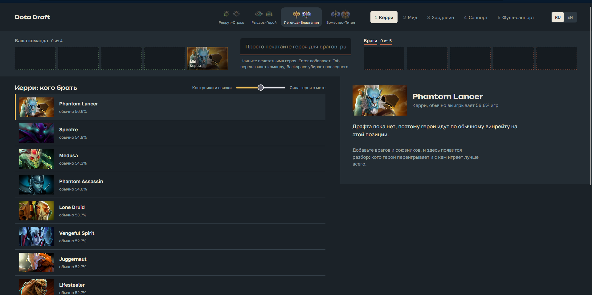

# Dota Draft

Подсказывает, кого брать в Dota 2, когда видно, кого пикнули враги и союзники. Выбираешь ранг и позицию, вбиваешь героев и получаешь список с объяснением, почему именно этот.

*English: a hero-pick helper for Dota 2. Enter your position and the picks so far, get ranked suggestions with reasons. The interface is available in Russian and English.*

Это альфа. Работает, но формула подобрана на глаз и пока ни на чём не проверена, так что цифры стоит читать как подсказку, а не как приговор.

## Как оно думает

Для каждого героя, которого вообще играют на твоей позиции, берётся обычный винрейт. К нему прибавляются поправки: насколько герой лучше или хуже обычного против каждого врага и вместе с каждым союзником. Пары, по которым мало игр, не учитываются. У остальных цифра подтягивается к среднему, чтобы тридцать удачных матчей не делали из героя бога.

Считается всё в браузере. Статистика лежит готовыми файлами, сервера у проекта нет, и расчёт занимает около миллисекунды.

Ползунок «Контрпики и связки / Сила героя в мете» решает, что важнее: матчапы или просто то, что герой сейчас силён.

## Откуда данные

Матчапы и винрейты берутся из STRATZ API. Раз в сутки GitHub Actions собирает свежий снапшот и обновляет сайт. Сначала я пробовал OpenDota, но на пару героев там выходит в среднем несколько десятков игр, на этом ничего не построишь.

Оговорки. STRATZ отдаёт матчапы четырьмя группами рангов (Рекрут и Страж, Рыцарь и Герой, Легенда и Властелин, Божество и Титан), поэтому восемь медалей в интерфейсе объединены в пары. Матчапы к тому же посчитаны сразу по всем позициям. Если герой силён против кого-то, это могло набраться на другой роли, поэтому героев, которых на выбранной позиции почти не играют, подсказки пропускают.

## Запустить у себя

Нужны Node 20 или новее и pnpm. Токен STRATZ бесплатный, его выдают на stratz.com/api.

    git clone https://github.com/<ник>/dota-draft.git
    cd dota-draft
    pnpm install

    export STRATZ_TOKEN=...      # в PowerShell: $env:STRATZ_TOKEN = "..."
    pnpm snapshot                # собрать данные, занимает пару минут
    pnpm names:fetch             # русские названия героев, нужен один раз
    pnpm export:web              # разложить данные для сайта
    pnpm dev

Медали рангов подтягиваются командой `pnpm ranks:fetch`. Без неё сайт рисует запасные. Тесты: `pnpm test`.

Устройство простое: `packages/core` это формула без интерфейса и сети, `packages/pipeline` скачивает и собирает данные, `packages/web` сам сайт на React и Vite.

## Чего ещё нет

- Проверки формулы на реальных матчах. Сейчас параметры взяты по ощущению.
- Разбивки по ролям и синергии на линии.
- Учёта порядка пиков, банов и состава команды (контроль, магический урон).
- Подсказок поверх игры по распознаванию экрана пика. Это отдельная большая затея, пока только в планах.

## Права

Dota 2 и всё с ней связанное принадлежит Valve Corporation. Портреты героев и медали рангов тоже её, в репозитории их нет, они подтягиваются при сборке сайта. Проект неофициальный и с Valve не связан. Статистика приходит из STRATZ, с ними проект тоже не связан.

Код лежит под лицензией MIT (файл `LICENSE`). Она касается только кода, не графики Valve и не данных STRATZ.